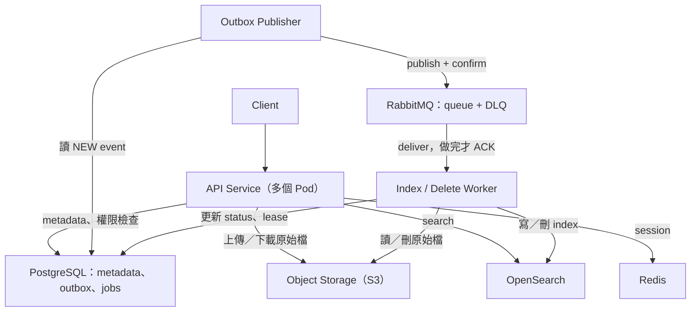

# Exercise 2：Distributed Document Search Platform

## 1. 範圍和假設

使用者可以上傳、看、下載、搜尋、刪除自己的文件，搜尋結果會帶文件、命中的 snippet 和 highlight

下面的效能數字是設計目標，還沒有實際壓測過

| 項目 | 題目給的規模 |
|---|---|
| Users | 100 萬 |
| Documents | 1,000 萬份，平均 2 MB |
| Peak upload | 每秒 100 份 |
| Peak search | 3,000 QPS |
| Search latency | 通常 < 500 ms |
| Indexing freshness | 上傳後 5 分鐘內要搜得到 |

我的假設：

- 第一版只有 owner 能看到自己的文件，分享功能放在第 15 節
- 支援 TXT 和抓得到文字的 PDF／EPUB，OCR 和加密檔先不做
- 「通常 < 500 ms」我定義成：正常流量下 end-to-end p95 < 500 ms
- 5 分鐘從 API 回 `202`（上傳成功）開始算
- 文件上傳後不能改，重新上傳就是一份新文件
- **Retry 不會產生重複，但使用者自己把同一個檔案上傳兩次，就當成兩份文件**
  - 如果產品想擋，可以在同一個 owner 底下用 content hash 提醒或直接擋
  - 不做跨使用者去重，不然使用者可以從上傳速度猜出別人有沒有同一個檔案

## 2. 容量估算

| 項目 | 怎麼算、為什麼 | 結果 |
|---|---|---|
| 原始檔 | 1,000 萬 × 2 MB | 20 TB（放 Object Storage） |
| 上傳頻寬 | 每秒 100 份 × 2 MB | 200 MB/s ≈ 1.6 Gbps |
| 抽出來的文字 | PDF／EPUB 裡有字型、圖片、排版，假設文字大概是原檔的 50% | 約 10 TB |
| OpenSearch 一份資料 | 要存原文（做 snippet／highlight 用）加上 inverted index（含詞的位置），假設是文字的 1–1.5 倍 | 10–15 TB |
| 加 replica 和預留空間 | 1 份 replica 所以 ×2，再多抓 30% 給 segment merge 和磁碟水位 | 約 30–40 TB disk |
| Primary shards | 一個 shard 建議 30–50 GB，12 TB ÷ 40 GB | 約 300 個 |
| Indexing 併發 | 假設一份要處理 2 秒：每秒 100 份 × 2 秒 = 200，再多留 50% | 大約要能同時處理 300 份 |

倍率和處理時間都是假設，要拿真實的文件測過再調整

## 3. 架構



| 元件 | 負責什麼 | 為什麼選它 |
|---|---|---|
| PostgreSQL | metadata、文件狀態、outbox、jobs | 需要 transaction、unique constraint 和條件更新 |
| Object Storage（S3） | 原始檔 | 20 TB 的大檔不適合塞 DB，容量和頻寬可以分開擴 |
| OpenSearch | 全文搜尋、ranking、highlight | 內建 inverted index、shard 分散和 highlight |
| RabbitMQ | indexing／delete 任務、retry、DLQ | 上傳尖峰時當緩衝，worker 掛掉訊息會重送 |
| Redis | session | 讓多個 API Pod 共用登入狀態 |

**PostgreSQL 是 source of truth，OpenSearch 只是衍生資料，壞掉可以重建**

這三種儲存之間沒辦法開同一個 transaction，所以一致性靠 outbox、idempotent 寫入和 reconciliation job 來顧

## 4. API

`user_id` 一律從 session 拿，不相信前端傳來的 owner

| 操作 | API | 回應 |
|---|---|---|
| 上傳 | `POST /documents`（header 帶 `Idempotency-Key`） | `202`：`document_id`、`status` |
| 查狀態 | `GET /documents/{id}` | `200`：名稱、`status`、時間 |
| 看／下載 | `GET /documents/{id}/content` | `200`：串流原始檔 |
| 搜尋 | `GET /documents?q=cat&limit=20&cursor=...` | `200`：文件、snippet、highlight、`next_cursor` |
| 刪除 | `DELETE /documents/{id}` | `202`：刪除中 |

- 同一個 user 帶同一個 `Idempotency-Key`：回同一份文件，key 一樣但內容不一樣就回 `409`
- 同一個 key 的兩個請求同時進來：unique constraint 只會讓一個寫成功，輸的那個讀出贏家的資料，回同一個 `document_id`，自己傳上去的檔案交給孤兒清理 job
- 沒登入回 `401`，不是 owner 和文件不存在都回 `404`，不讓人知道文件到底存不存在
- 看／下載不用等 index 做完
- 超過 rate limit 回 `429`，下游掛掉就在 timeout 內回 `503`

## 5. 資料模型

### `documents`

| 欄位 | 說明 |
|---|---|
| `document_id` | UUID，後端產生，PK |
| `owner_id` | 從 session 來 |
| `name`、`size_bytes`、`content_type` | 文件資訊 |
| `status` | 文件狀態，看下表 |
| `object_key` | 原始檔放哪，例如 `documents/{document_id}/original` |
| `idempotency_key`、`request_hash` | 認出 retry，`UNIQUE(owner_id, idempotency_key)` |
| `created_at`、`indexed_at`、`deleted_at` | 時間 |

| Status | 意思 |
|---|---|
| `PENDING` | 原始檔存好了，等著做 indexing |
| `INDEXING` | worker 正在處理 |
| `READY` | 搜得到了 |
| `INDEX_FAILED` | indexing 失敗，但原始檔還是可以下載 |
| `DELETING` | 已經不給看了，背景正在清 |
| `DELETED` | 原始檔和 index 都清掉了，留一筆紀錄 |

還沒刪的狀態都可以進 `DELETING`，但 `DELETING`／`DELETED` 不能再被改回 `READY`

### `outbox_events` 和 `processing_jobs`

| 表 | 主要欄位 | 用來做什麼 |
|---|---|---|
| `outbox_events` | `event_id`、`document_id`、`event_type`（`INDEX_DOCUMENT`／`DELETE_DOCUMENT`）、`state`（`NEW`／`SENT`） | 等著送去 MQ 的 event，payload 只放 `document_id`，不放檔案內容 |
| `processing_jobs` | `event_id`（UNIQUE）、`status`、`attempts`、`lease_token`、`lease_until`、`last_error` | worker 的處理紀錄，`SENT` 只代表 MQ 收到了，有沒有做完要看這張表 |

## 6. 上傳和 indexing 流程

1. API 檢查 session、檔案大小和格式，如果 `Idempotency-Key` 已經有了，就比對 `request_hash` 然後回原本那份文件
2. 產生 `document_id`，把原始檔串流寫進 Object Storage
3. 開一個 DB transaction，同時寫 `documents`（`PENDING`）和 `outbox_events`（`INDEX_DOCUMENT`），commit 完回 `202`
4. Publisher 撈 `NEW` 的 event 送去 RabbitMQ，收到 publisher confirm 才改成 `SENT`，沒收到就重送
5. Worker 收到訊息，寫一個新的 `lease_token` 拿到 lease，把文件改成 `INDEXING`，如果文件已經在刪了，就改去做清理
6. 抽出文字，用 `document_id` 當 OpenSearch 的 `_id` 寫進去，並帶 `refresh=wait_for`
7. 寫完再看一次文件狀態：已經在刪就把剛寫的 index 刪掉，不然就在同一個 transaction 把 job 改成 `COMPLETED`、文件改成 `READY`
8. DB commit 完才 ACK

**為什麼要 outbox：** 如果 API 自己先寫 DB 再送 MQ（或反過來），中間掛掉資料就會對不起來

- 先 commit 再 publish：publish 之前掛掉，event 就不見了，文件永遠卡在 `PENDING`
- 先 publish 再 commit：commit 失敗，MQ 裡就多了一個根本不存在的文件的任務

Outbox 讓「文件資料」和「要送的 event」在同一個 transaction 裡，一起成功或一起失敗，之後再交給 publisher 送去 MQ，沒收到 confirm 就重送

**為什麼要 `refresh=wait_for`：** OpenSearch 是 near-real-time，寫進去之後要等下一次 refresh（預設大約 1 秒）才搜得到

- 寫完馬上標 `READY`：使用者剛好去搜，可能會搜不到
- 用 `refresh=true`：馬上搜得到，但每份文件都強制 refresh，每秒 100 份會產生一堆小 segment，很貴
- 用 `wait_for`：不強制 refresh，只是等下一次 refresh 做完才回來，兩邊的問題都沒有

**上傳路徑：** 檔案經過 API 串流到 Object Storage，檢查和 idempotency 在同一個 request 裡做完，流程比較單純

另一個做法是 presigned URL，讓前端直接傳到 S3，不吃 API 頻寬，但上傳就要拆成「拿 URL → 上傳 → 通知完成」三步

**孤兒檔案：** 檔案寫進去了但 DB commit 失敗，會留下沒人用的檔案，用定期的清理 job 把放太久還沒人用的檔案刪掉

## 7. Retry、idempotency 和 DLQ

RabbitMQ 是 at-least-once，同一個訊息可能送好幾次，所以每一步都要 idempotent

| 可能重複的地方 | 怎麼擋 |
|---|---|
| 同一個上傳 request 重試 | `UNIQUE(owner_id, idempotency_key)`，回同一個 `document_id` |
| 同一份文件重複寫 index | `_id = document_id`，重寫只會蓋掉同一筆 |
| 同一個任務重複處理 | `processing_jobs.event_id` UNIQUE，已經 `COMPLETED` 就直接 ACK |

**Lease 多長：** 設 60 秒，worker 處理中每 20 秒續約一次，大檔案慢慢做也不會被搶走，worker 掛了最多 60 秒就會被接手，遠低於 5 分鐘的 freshness

**Worker 被接手：** lease 過期後，別的 worker 會換一個新的 `lease_token` 接手，所有狀態更新都要帶 token 條件：

```sql
UPDATE processing_jobs SET status = 'COMPLETED'
WHERE event_id = :event_id AND lease_token = :my_token;
```

舊的 worker 醒來後更新到 0 筆，就知道任務已經不是它的，不會把文件改成 `READY`

它之前寫進 OpenSearch 的資料因為 `_id` 一樣不會重複，如果文件已經被刪了，就交給第 9 節的檢查和 reconciliation job 清掉

- 暫時性錯誤（timeout、`503`）：exponential backoff + jitter，有次數上限
- 不能重試的錯誤（檔案壞掉）或超過次數上限：丟進 DLQ 並發告警，文件標成 `INDEX_FAILED`，修好之後可以從 DLQ 重送，重送前要再檢查一次文件狀態
- Worker 用 manual ACK，DB commit 完才 ACK，worker 掛掉的話，沒 ACK 的訊息 RabbitMQ 會重送

## 8. 搜尋和權限

1. 從 session 拿 `user_id`
2. 查 OpenSearch：關鍵字加上 `owner_id` filter，並用 `owner_id` 做 routing
3. OpenSearch 回候選文件、snippet 和 highlight，snippet 是查詢的時候依照詞的位置當場算，不會先存好
4. 拿候選的 `document_id` 一次批次去查 PostgreSQL primary，只留下 owner 對、而且 `status = READY` 的文件
5. 回傳結果和 `next_cursor`

**Owner routing：** 把同一個 owner 的文件放在同一個 shard

- 沒有 routing：每次搜尋都要查全部大約 300 個 shard，3,000 QPS 等於每秒查 90 萬次 shard
- 有 routing：只要查 1 個 shard
- 寫入和刪除也都要帶一樣的 routing
- 代價是文件特別多的 owner 可能讓某個 shard 特別忙，要監控
- 遇到這種大客戶，可以用 `routing_partition_size` 把一個 owner 分散到幾個 shard，或讓他獨立一個 index

**為什麼還要查 DB：** index 可能比 DB 慢，例如剛刪的文件還留在 OpenSearch

查 primary 不查 read replica，因為 replica 有複製延遲，剛刪的文件在 replica 上可能還是 `READY`

這是用 primary key 批次查，3,000 QPS 還扛得住

查 DB 失敗或 timeout 就回 `503`，不會直接回 OpenSearch 的結果，寧可報錯也不能回傳已刪除或沒權限的文件

**過濾完不夠一頁：** 在時間內再跟 OpenSearch 多抓一次，來不及就回比較短的一頁加 `next_cursor`

不回 OpenSearch 的 total hits，因為裡面算到了還沒經過 DB 確認的文件，數字不準

Highlight 結果要先做 HTML escape，不然文件內容可能被瀏覽器當成 HTML 執行

已知限制：對 2 MB 的大欄位做 highlight 比較貴，如果壓測發現太慢，可以把文件切成段落（chunk）分開 index

## 9. 刪除

1. API 確認是 owner 之後，在同一個 transaction 把文件改成 `DELETING`，並寫一筆 `DELETE_DOCUMENT` outbox event，然後回 `202`
2. 從這一刻開始，搜尋（DB 檢查會過濾掉）、看、下載都拿不到這份文件
3. Worker 刪原始檔和 index，東西本來就不存在也算成功，所以可以放心 retry
4. 兩個都刪掉之後改成 `DELETED`

**刪除和 indexing 同時發生：** indexing worker 可能在刪除做完之後才把 index 寫進去

所以 worker 寫 index 前後都會看文件狀態，看到 `DELETING`／`DELETED` 就把自己寫的東西刪掉

另外有 reconciliation job 定期檢查 `DELETED` 文件的 index 真的清掉了，也會抓出卡在 `PENDING`／`INDEXING`／`DELETING` 太久的文件

## 10. 擴充和高可用

| 層 | 怎麼擴 |
|---|---|
| API | 無狀態，多 Pod + load balancer，用 HPA 看 CPU 和延遲調整 |
| Worker | 看 queue 積了多少、最舊的訊息等多久來擴，但要限制總併發，不然會把 OpenSearch 和 DB 打爆 |
| OpenSearch | 寫入量靠 primary shards 分散，搜尋量靠加 replica 和 data node |
| PostgreSQL | 優化查詢和 index、限制 connection pool |
| Object Storage | 託管服務，容量和頻寬會自己擴 |

瓶頸在 OpenSearch 或 DB 的時候，加 API Pod 只會把更多請求推到下游，沒用

| 元件 | 怎麼做高可用 |
|---|---|
| PostgreSQL | 跨 AZ primary／standby，自動 failover，定期備份並實際練習還原 |
| Redis | Sentinel 或託管 HA，failover 可能掉一點 session，使用者重新登入就好 |
| RabbitMQ | 3 個節點的 cluster + quorum queue，壞 1 個節點還能跑 |
| OpenSearch | 每個 primary shard 至少 1 個 replica，放在不同節點／AZ，定期 snapshot |

## 11. Kubernetes 部署

- API、publisher、worker 各自一個 Deployment，各自設 resource requests／limits 和 HPA
- 用 rolling update，新舊版本同時在跑的時候，event 格式要互相看得懂
- Readiness probe 沒過就不接流量，liveness probe 只檢查程式本身有沒有卡死，不要因為 DB 暫時掛掉就一直重啟
- Worker 收到 SIGTERM：不再收新訊息，在 grace period 內把手上的做完並 ACK，做不完的就不 ACK，交給別的 worker
- PostgreSQL、RabbitMQ、OpenSearch 優先用託管服務，真的要自己架就用 StatefulSet／Operator 加 persistent volume
- 帳密放 Kubernetes Secret 或 secret manager，DB、MQ、OpenSearch 都不對外開

## 12. 監控

| 看什麼 | 指標 |
|---|---|
| 搜尋 | p50／p95／p99 latency、error rate、`429`／`503` 數量 |
| Freshness | 上傳到 `READY` 花多久、超過 5 分鐘還沒好的文件數 |
| Queue | Ready、Unacked、DLQ 數量、最舊還沒送出的 outbox event 等了多久 |
| Worker | 每份處理多久、retry 幾次、lease 過期幾次 |
| OpenSearch | search latency、thread pool rejected、CPU、JVM heap、shard 狀態 |
| DB | slow query、connection pool 等多久、replication lag |
| 刪除 | 卡在 `DELETING` 多久、reconciliation job 找到多少殘留的 index |

- Structured log 帶 `document_id`、`event_id`、`trace_id`、狀態和錯誤，不記文件內容和 session token
- 用 distributed tracing 把 API → publisher → worker 串起來，看時間花在哪一段
- Freshness 的告警要比 5 分鐘早響（例如超過 3 分鐘還沒 `READY` 的文件變多），不要等使用者來反應

## 13. 五個情境

| 情境 | 怎麼處理 |
|---|---|
| 上傳 30 分鐘還搜不到 | 照順序查：`documents.status` → outbox event 有沒有 `SENT` → queue 的 Ready／Unacked／DLQ → 用 `document_id` 查 worker log → OpenSearch 有沒有這筆 `_id`、owner filter 和分詞對不對<br>修好卡住的地方後重送 event，不用叫使用者重新上傳 |
| Worker 處理到一半掛掉 | 沒 ACK 的訊息 RabbitMQ 會重送，新的 worker 換一個 `lease_token` 接手，`_id` 固定，重做也不會重複 |
| 同一個訊息送了好幾次 | 用 `event_id` 認出是同一個任務，`_id = document_id` 讓寫入 idempotent，狀態更新帶 lease token 和狀態條件 |
| Indexing 做到一半文件被刪 | 刪除馬上生效（DB 改成 `DELETING`，搜尋時 DB 檢查會擋掉），worker 寫入前後檢查狀態並把自己寫的刪掉，漏掉的交給 reconciliation job |
| 搜尋流量突然變 10 倍 | 先看 tracing 的分段延遲找出卡在哪<br>短期：per-user rate limit、超過就快速回 `429`、限制查詢成本（每頁筆數、highlight 數量）<br>長期：加 replica 和 data node，因為 OpenSearch 擴容要搬 shard，沒辦法馬上生效 |

## 14. 取捨

- **非同步 indexing：** 上傳回應快，代價是文件不會馬上搜得到（eventual consistency），所以要有狀態 API 和 freshness 監控
- **分三種儲存：** 各做各擅長的事，代價是跨系統的一致性要靠 outbox、補償刪除和 reconciliation job
- **At-least-once：** 比 exactly-once 簡單可靠，代價是每一步都要 idempotent
- **搜完再查 DB：** 保證不會回傳已經刪掉或沒權限的文件，代價是每次搜尋多查一次 DB
- **Owner routing：** 搜尋只查一個 shard，代價是可能有 hot shard，而且加了分享功能就要調整

## 15. 延伸：分享文件

- 加一張 `document_permissions(document_id, user_id, role)`，PK 是 `(document_id, user_id)`
- OpenSearch 每份文件加 `allowed_user_ids`，搜尋 filter 改成「`allowed_user_ids` 裡有我」
- 權限改了就送 event 非同步更新 index，還沒更新完的那段時間由 DB 檢查擋住
- 別人分享的文件不在我的 routing shard 上，搜尋要改成查全部 shard，或是把「自己的文件」和「別人分享給我的」分開查

## 16. 驗證計畫

- 拿真實的文件測 index 倍率和 worker 處理時間，回頭修正第 2 節的估算
- 壓測 3,000 QPS 搜尋 + 每秒 100 份上傳，確認 p95 和 5 分鐘 freshness 有達到
- 故意製造故障：kill worker、MQ／DB 暫時斷線、重複訊息、刪除和 indexing 同時發生，確認不會看到別人的文件、不會重複、最後都清得乾淨

## 參考文件

- [Amazon S3：Objects](https://docs.aws.amazon.com/AmazonS3/latest/userguide/UsingObjects.html)
- [OpenSearch：Intro to OpenSearch](https://docs.opensearch.org/latest/getting-started/intro/)
- [RabbitMQ：Consumer Acknowledgements and Publisher Confirms](https://www.rabbitmq.com/docs/confirms)
- [RabbitMQ：Quorum Queues](https://www.rabbitmq.com/docs/quorum-queues)
- [PostgreSQL：High Availability and Replication](https://www.postgresql.org/docs/current/warm-standby.html)
- [Kubernetes：Probes](https://kubernetes.io/docs/concepts/workloads/pods/probes/)
- [Kubernetes：Horizontal Pod Autoscaling](https://kubernetes.io/docs/concepts/workloads/autoscaling/horizontal-pod-autoscale/)
